&nbsp;&nbsp;
&nbsp;&nbsp;
&nbsp;&nbsp;
&nbsp;&nbsp;

### About me

- **Data Engineer**, ex-<a href="https://www.capgemini.com/in-en/" title="Capgemini · Global IT services and consulting company; data engineering work in Bengaluru.">Capgemini</a> (Bengaluru). I build data platforms end to end: ingestion, modelling, quality, release and operations.
- I work mostly in **PySpark, SQL, Python and Databricks**, with Azure and AWS.
- **Cyber Security graduate**, so privacy and least privilege come first: masks, tokens, service principals, no secrets in Git.
- Off the keyboard: ♟️ chess.

### Featured project

| Repo | What it is |
|---|---|
| [**flexi_quant_finance_fd**](https://github.com/the-naman/flexi_quant_finance_fd) | The acquired lender: 8 messy sources in 6 formats (incl. PDF and OCR), SCD2, a Kafka payment stream with a failed-payment alert |
| [**bio_health_group_hd**](https://github.com/the-naman/bio_health_group_hd) | The healthcare parent: its own lakehouse plus the nightly group view across both companies |

Both run on Databricks with dev, test and prod, pull-request approvals, CI checks and tests, column masks and HTML alert mails. All data is synthetic.
Hover any box for details on the [live dashboard](https://the-naman.github.io/the-naman/).

### Skills & Tools

 

 

 

 

 

 

 

 

### GitHub activity

<b>Activity details: busiest day and week, monthly totals, every language</b>

<b>Trophy details: your rank and the next target for each trophy</b>

<a href="https://github.com/the-naman" title="Contribution graph">
<picture>
  <source media="(prefers-color-scheme: dark)" srcset="https://raw.githubusercontent.com/the-naman/the-naman/output/snake-dark.svg" />
  <source media="(prefers-color-scheme: light)" srcset="https://raw.githubusercontent.com/the-naman/the-naman/output/snake-light.svg" />
  
</picture>
</a>

### Support me

If my work helped you, you can support it here. Thank you!

Built from <code>config/profile.yml</code> by the scripts in this repo; live cards refresh every 3 hours. The visitor counter is komarev.com and only sees GitHub's image proxy, never you.

